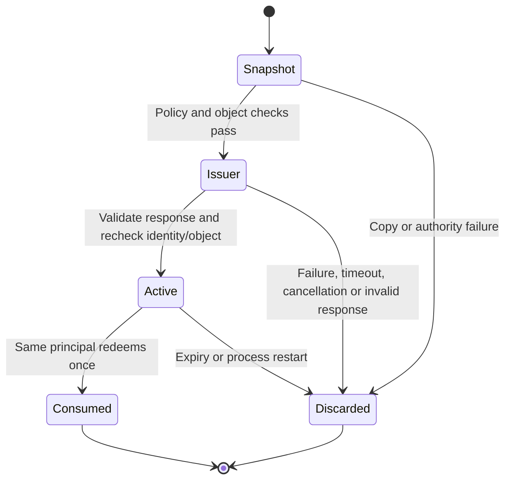

# Delegated artifact links

Release status: included in the [v0.8.2-rc.1 source candidate](release-notes-0.8.2-rc.1.md),
prepared for automated qualification. v0.8.1 remains the stable release.

The optional hosted service can ask a configured platform to choose a download
URL in that platform's own URL space. Infimount still owns the artifact grant
and authenticates every redemption. A delegated URL is a presentation link. It
does not become an anonymous bearer credential or grant storage access to the
issuer.

This completes the bounded delegated issuer contract accepted in
[ADR 0013](adr/0013-artifact-integrations-and-distribution.md) and issue #252.
The desktop's existing native download links are unchanged. Hosted delivery
defaults to its direct authenticated proxy, described in
[the hosted service guide](hosted-artifact-service.md).

## Configure an issuer

Add this field to the trusted hosted configuration:

```json
{
  "delivery": {
    "mode": "delegated",
    "issuer_url": "https://links.example.com/infimount/issue",
    "issuer_token": {
      "kind": "file",
      "path": "/run/secrets/infimount-link-issuer-token"
    },
    "returned_url_origin": "https://app.example.com",
    "timeout_milliseconds": 2000
  }
}
```

The issuer destination is a static HTTPS URL without a query, fragment or URL
credentials. Its path is allowed. `returned_url_origin` must be an exact
canonical HTTPS origin, including a nondefault port if used. A path, trailing
slash, fragment, query or redundant `:443` is not an origin. Responses must use
that origin. The server does not follow the returned URL.

The dedicated issuer credential is resolved from an explicit mounted file or
environment reference. An environment reference has this form:

```json
{"kind": "env", "name": "INFIMOUNT_LINK_ISSUER_TOKEN"}
```

Use a dedicated bearer credential between Infimount and the issuer. The value
must contain 16–4096 ASCII characters from `A–Z`, `a–z`, `0–9`, `-._~+/=`.
Mounted-file trailing newlines are trimmed. No inline credential, ambient
credential lookup, OAuth token forwarding or storage credential forwarding is
supported. Configuration and secret references are trusted application input,
never MCP tool arguments.

Omit `delivery`, or set it to `{"mode":"proxy"}`, to retain direct proxy links.
Proxy mode does not construct an issuer client, resolve an issuer credential or
send an issuer request. Switching modes requires configuration reload through a
process restart, which also invalidates the service's in-memory grants.

## Request and response contract

Infimount sends one `POST` to `issuer_url` with these headers:

```http
Authorization: Bearer <dedicated issuer credential>
Content-Type: application/json
Accept: application/json
Cache-Control: no-store
```

The dedicated credential is the only authorization sent to the issuer. The
request has exactly these six fields:

```json
{
  "version": 1,
  "grant_id": "36a4f386-764f-43f3-bb12-1f8c547913bd",
  "redeem_url": "https://artifacts.example.com/downloads/36a4f386-764f-43f3-bb12-1f8c547913bd",
  "expires_at_unix_seconds": 1795824030,
  "requires_authorization": true,
  "single_use": true
}
```

`grant_id` is a newly generated opaque UUID. At the time of the webhook call it
is provisional and cannot be redeemed. `redeem_url` is on Infimount's configured
public origin. It contains no backend address or raw storage path. Expiry is
fixed by the original request, configured grant limit and authenticated token's
remaining lifetime. Delegated expiry is rounded down to a whole Unix second.

The issuer returns HTTP `200` and `Content-Type: application/json`, optionally
with exactly `; charset=utf-8`, containing exactly these four fields:

```json
{
  "version": 1,
  "grant_id": "36a4f386-764f-43f3-bb12-1f8c547913bd",
  "url": "https://app.example.com/artifacts/36a4f386-764f-43f3-bb12-1f8c547913bd",
  "expires_at_unix_seconds": 1795824030
}
```

The version, grant ID and expiry must exactly match the request. The issuer
cannot extend or substitute the grant. `url` must be an absolute, canonical
HTTPS URL of at most 2048 ASCII bytes on the configured origin. A path and query
are allowed, including percent-encoded path text. URL credentials, fragments,
whitespace, controls, backslashes, alternate ports, normalization tricks and
different origins are rejected. Unknown fields, duplicate fields and wrong
JSON types are rejected.

The request deliberately contains no principal fields, tenant or client IDs,
storage IDs, raw paths, object bytes, object checksums, OAuth tokens or storage
credentials. The issuer only needs enough information to map an opaque
platform link to the authenticated Infimount redemption endpoint.

### Exchange bounds

| Bound | Value |
| --- | --- |
| Issuer request body | At most 4096 bytes |
| Issuer response body | At most 8192 bytes, enforced while streaming |
| Accepted response headers | At most 32 headers and 16 KiB of names/values/framing allowance |
| Configured timeout | 100–5000 ms, default 2000 ms |
| Effective timeout | Also bounded by the grant's remaining lifetime and the enclosing request deadline |
| Redirects and automatic retries | Disabled |
| Ambient HTTP proxy settings | Disabled for this client |
| Response compression | Rejected |
| Caller-selected issuer URL or delivery mode | Rejected by the MCP input schema |

The client uses HTTP/1.1 with TLS certificate verification. Its underlying HTTP
parser also has its own fixed bounds. The accepted-header limit above is checked
after parsing and is not a custom replacement for the HTTP parser's limits.

## Provisional lifetime and cleanup



Infimount captures and verifies a private snapshot using the same bounded
staging budget as direct proxy downloads. The snapshot and its reservation stay
local to the issuing request while the webhook runs. No live map entry exists
yet. A failed, timed-out, malformed or canceled issuance drops that state and
releases quota. An ID observed by an unsuccessful issuer cannot later be used
to obtain the snapshot.

After a valid response, Infimount rechecks the original principal, scope, policy
revision, current object identity and expiry. Only then does it publish the
owner-bound grant synchronously. Redemption applies the original checks again,
consumes the ID once and streams the verified snapshot. Wrong-user attempts do
not consume the owner's grant. A changed source object cannot be substituted.

An issuer may have created a platform record before the caller times out or
disconnects. Such a record is inert if Infimount never activates its grant.
Issuers should expire their mappings at the supplied expiry and make issuance
idempotent by `grant_id`. There is no external revocation callback or durable
transaction across the two services. Security does not depend on deleting an
inert platform record. Process restart invalidates all Infimount grants.

## Redemption and platform authentication

For delegated mode, `create_download` returns the ordinary grant receipt plus:

```json
{
  "delivery": "delegated",
  "url": "https://app.example.com/artifacts/36a4f386-764f-43f3-bb12-1f8c547913bd",
  "redeem_url": "https://artifacts.example.com/downloads/36a4f386-764f-43f3-bb12-1f8c547913bd",
  "authorization_audience": "https://artifacts.example.com/mcp",
  "expires_at_unix_seconds": 1795824030,
  "requires_authorization": true,
  "single_use": true
}
```

The complete receipt also contains `download_id`, remaining `expires_seconds`,
`size_bytes`, `sha256` and `content_type`. The content is still served as a safe
`application/octet-stream` attachment, with `private, no-store`, `nosniff` and
no-referrer headers. A single-range redemption still consumes the grant.

The platform URL uses the platform's own browser login or session. **Send the
Infimount OAuth token only to `redeem_url` on Infimount's configured origin.**
The platform can relay a download through a backend that already holds the
original user's valid Infimount access token. It can alternatively let an
authenticated application client redeem directly. The issuer webhook never
receives that token.

The access token at redemption must preserve the full original issuer,
subject, tenant and client binding, have the required read/download scopes and
remain valid. A different user, tenant or OAuth client is rejected even if that
caller knows the platform URL or opaque grant ID. The dedicated webhook
credential cannot redeem a download. This feature does not add anonymous
sharing, cross-user delegation, publication approval or a general OAuth token
exchange.

## Audit and qualification

The existing `create_download` and `artifact_download` audit events remain.
`delegate_download` records issuer success, failure, timeout and cancellation
using the normal sanitized identity, hashed-path and fixed-outcome schema.
Issuer URLs, platform URLs, grant IDs, credentials, response bodies and raw
storage paths are never added to these events. External response text and
network errors are reduced to stable public error codes.

The focused tests use controlled local HTTP fixtures only through a test-only
constructor. Production configuration always requires HTTPS. They cover the
exact request allowlist and dedicated authorization, disabled mode, URL pinning,
strict JSON, response limits, redirect refusal, timeout, cancellation, quota
cleanup, wrong-owner redemption, object changes, expiry, replay and audit
redaction. Run the hosted library suite with:

```sh
cargo test -p infimount_hosted --lib
```

These fixtures qualify the adapter contract. A platform must still implement
and operate its own HTTPS issuer and authenticated presentation route. No
external issuer is enabled or deployed by the repository change.
