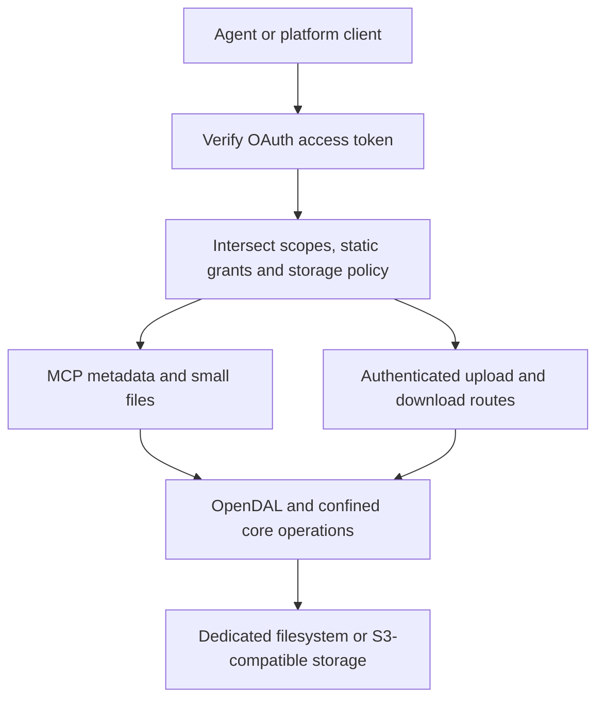

# Hosted artifact service

Release status: included in the [v0.8.2-rc.1 source candidate](release-notes-0.8.2-rc.1.md),
prepared for automated qualification. v0.8.1 remains the stable release.

The candidate adds the optional `infimount-hosted` executable for an authenticated storage
data plane for agent platforms. It runs independently of the desktop browser and
its loopback MCP sidecar. The accepted scope is recorded in
[ADR 0012](adr/0012-hosted-artifact-data-plane.md) and the integration extension in
[ADR 0013](adr/0013-artifact-integrations-and-distribution.md).

The initial service supports **one Linux replica**, dedicated local storage and
S3-compatible storage. It provides scoped browsing, binary reads, create-only
writes and authenticated artifact transfers. It does not enable the separate
live-provider execution pilot or establish external identity-provider qualification.



## Start explicitly

Build and validate from the repository root:

```bash
cargo build --locked -p infimount_hosted --release
target/release/infimount-hosted check --config deploy/hosted/example-local.json
target/release/infimount-hosted check --config deploy/hosted/example-s3.json
```

`check` validates the configuration schema and limits. It does not contact an
identity provider, resolve credentials, start a listener or test storage access.
`serve` loads the configured JWKS and storage authority before serving traffic:

```bash
target/release/infimount-hosted serve --config /etc/infimount/hosted.json
```

`INFIMOUNT_HOSTED_CONFIG` can supply the configuration path when `--config` is
omitted. The `serve` command is still mandatory. There is no implicit start,
desktop settings lookup, native keyring lookup or fallback to insecure HTTP auth.

The listener is plain HTTP behind a trusted TLS ingress. `public_url` must be the
canonical external HTTPS origin, for example `https://storage.example.com`.
The expected access-token audience is exactly that origin plus `/mcp`.
Non-loopback binding also requires `allow_non_loopback: true`.

Ingress must preserve the public Host header, reject direct untrusted access to
the backend, and terminate TLS. The application validates Host and accepts only
the configured public origin when an Origin header is supplied. Forwarded
identity headers are not authentication. The initial service does not enable
cross-origin browser access.

The container and Kubernetes examples can be prepared locally:

```bash
docker build -f deploy/hosted/Dockerfile -t infimount-hosted:local .
kubectl kustomize deploy/hosted
```

The manifests use one non-root replica, a read-only container root, bounded
temporary storage, a dedicated artifact volume and a ClusterIP service. They
do not create a public ingress or provision an identity provider. The image
must be available in the deployment's registry, and the trusted issuer, public
origin, TLS ingress and storage configuration must agree before deployment.
Rendering the manifests performs no cluster mutation.

The canonical release workflow qualifies native Linux amd64 and arm64 images,
then publishes a combined image at `ghcr.io/infimount/infimount-hosted:<release-tag>`.
The release's `hosted-image.json` contains the immutable image digest, both
platform digests and the exact source commit. Pin deployments to that digest.
The [distribution guide](artifact-distribution.md) explains verification and the
separate stable/prerelease tags. Source builds remain available without a registry.

Qualification includes starting the production executable and each native image,
then exercising real TLS/OAuth requests against a dedicated filesystem and a
disposable S3 emulator. The process harness covers exact artifact bytes, two-user
isolation, grant lifecycle, delegated platform login and telemetry. The offline
`check` command remains a configuration assertion only. See the
[acceptance review](artifact-acceptance-review.md) for the requirements matrix,
regressions and limits of this evidence.

If `public_url` changes, update the Host header in the startup, liveness and
readiness probes to match its authority. The sample NetworkPolicy permits
ingress from pods labeled `app.kubernetes.io/component: controller` in the
`ingress-nginx` namespace and DNS from pods labeled `k8s-app: kube-dns` in
`kube-system`. Update those selectors for the deployment's ingress controller
and DNS service.

## Explicit configuration and storage ownership

Complete examples are provided for
[a dedicated local root](../deploy/hosted/example-local.json) and
[S3-compatible storage](../deploy/hosted/example-s3.json).
Their example domains, subjects and bucket describe a deployment configuration,
not provisioned resources. Use the issuer, audience, JWKS endpoint and subjects
registered for the deployment.

Both examples implement this fixed mapping:

| Verified subject | Verified tenant | Verified client | Storage path prefix |
| --- | --- | --- | --- |
| `alice` | `alpha` | `artifact-agent` | `/Artifacts/tenants/alpha/users/alice` |
| `bob` | `beta` | `artifact-agent` | `/Artifacts/tenants/beta/users/bob` |

The tenant and subject are matched against those records. Claim values are never
interpolated into paths. Prefixes must already be canonical. Empty prefixes,
dot segments, backslashes, percent escapes, control characters and private
staging directories are rejected. Unicode path segments are supported.

Effective authority requires all three conditions:

1. The verified token carries the operation's scope.
2. A configured grant matches issuer, subject, tenant and configured client.
3. The storage record is enabled and exposed, and its path policy allows the operation.

Storage policy defaults to `none` in the examples. Only the two explicit prefixes
allow read/write access. Their rules explicitly allow unattended create and
authenticated download operations. A policy requiring confirmation fails closed.
This service has no approval inbox and cannot approve its own request. Overwrite,
delete, move, administration and publication into desktop source storage are absent.

Local storage requires `dedicated_local: true` and an absolute operator-owned
directory. It must not be a user's home directory or a shared writable mount.
Linux descriptor-based traversal rejects symbolic-link escape and pins directories
and files used by OpenDAL. Publication uses atomic create-only behavior. A string
prefix or an ordinary OpenDAL filesystem root alone is not the confinement boundary.

S3 credentials are explicit references, for example:

```json
{
  "accessKeyId": {
    "kind": "file",
    "path": "/run/secrets/infimount/access-key"
  },
  "secretAccessKey": {
    "kind": "file",
    "path": "/run/secrets/infimount/secret-key"
  }
}
```

An environment reference has the form `{"kind":"env","name":"INFIMOUNT_S3_SECRET"}`.
Credential contents are resolved only into operator configuration. The input
configuration and public policy records retain references. Secret files are
limited to 64 KiB, terminal line endings are removed, and missing or malformed
values stop startup. Inline secrets, desktop `secret_ref` accounts and ambient
provider-credential discovery are rejected. The initial S3 configuration requires
explicit access-key and secret-key references, a region and an endpoint. Hosted
operator construction disables ambient configuration and instance metadata
loading. Bucket selection comes from `bucket` or `bucketName`. A separate S3
`root` field is rejected because it would not constrain the operator's namespace.
Remote S3 endpoints require HTTPS. HTTP is accepted only for a loopback fixture
endpoint.

The configuration file is bounded to 1 MiB. Unknown fields, duplicate storage
identities, duplicate grants, unsupported backends and invalid policy versions
stop startup. Configuration is immutable during a process lifetime. Apply policy
changes by replacing trusted configuration and restarting the single replica.
Restart invalidates all cursors and transfer grants.

## OAuth access-token contract

The service verifies the
[RFC 9068 access-token profile](https://www.rfc-editor.org/rfc/rfc9068.html),
with RS256 as its initially supported asymmetric algorithm. It acts as the
resource server in the [MCP authorization model](https://modelcontextprotocol.io/specification/latest/basic/authorization).
The identity provider remains responsible for login, client registration, consent
and access-token issuance.

| Field | Requirement |
| --- | --- |
| Header `alg` | `RS256` only |
| Header `typ` | Access-token media type `at+jwt` or `application/at+jwt`, case insensitive |
| Header `kid` | Bounded identifier matching a configured JWKS signing key |
| `iss` | Exact configured issuer string |
| `aud` | Must include the exact configured `public_url` plus `/mcp` |
| `sub`, `client_id`, `jti` | Required bounded nonempty strings |
| `tenant_id` | Required private claim, matched to the configured grant's `tenant` |
| `iat`, `exp` | Integer times, valid order, bounded lifetime, and unexpired token |
| `nbf` | Checked when present |
| `scope` | Space-separated scopes, bounded in count and length |

The default maximum token lifetime is one hour. Expiry has no grace period.
Issue time allows at most 30 seconds of clock skew into the future. ID tokens,
unsigned tokens, HMAC tokens, malformed registered claims, unrecognized critical
headers, embedded signing-key URLs and foreign audiences are rejected.

JWKS retrieval uses the explicit HTTPS URL from configuration, with redirects
disabled, a five-second timeout, a 64 KiB body limit and at most 32 RSA signing
keys. Duplicate key IDs or inappropriate key usage fail closed. The default cache
lifetime is five minutes. Refresh is single-flight and rate limited, including
unknown-key requests. Background refresh keeps readiness independent of incoming
traffic. A failed refresh never extends expired keys.

There is no token-introspection or per-token revocation store. Revocation takes
effect through token expiry, signing-key refresh or a policy change followed by
restart. Deployments that require immediate centralized revocation need an
additional qualified authorization mechanism.

Every protected HTTP request carries `Authorization: Bearer` with a valid token.
The same subject, tenant, issuer and client must redeem their transfer grant.
A refreshed token may be used if it preserves that identity and still has the
required scopes. A token does not authorize other subjects' grants, cursors or paths.

Protected resource metadata is available at
`/.well-known/oauth-protected-resource/mcp`. Authentication failures advertise
that metadata location. The service does not expose an authorization server or
mint access tokens.

## MCP surface

`POST /mcp` uses stateless Streamable HTTP. There are no application sessions,
server-side conversations, transport-session IDs, subscriptions or administrative
tools. Each operation obtains its principal from the authenticated request.

| Tool | Arguments | Required scope |
| --- | --- | --- |
| `list_dir` | `path`, optional `limit` and `cursor` | `infimount:read` |
| `stat_path` | `path` | `infimount:read` |
| `read_file` | `path`, optional `offset` and `max_bytes` | `infimount:read` |
| `write_file` | `path`, `content`, optional `encoding` and `content_type` | `infimount:create` |
| `create_download` | `path`, optional `ttl_seconds` | `infimount:read` and `infimount:download` |
| `create_upload` | `path`, `size`, `sha256`, optional `content_type` and `ttl_seconds` | `infimount:create` |
| `complete_upload` | `id` | `infimount:create` |
| `abort_upload` | `id` | `infimount:create` |

All tool schemas reject unknown arguments. `overwrite`, `create_parents`,
`session_id` and caller-defined roots cannot widen this surface. All writes are
create-only. A conflicting destination remains unchanged.

Paths use the configured storage name, for example
`/Artifacts/tenants/alpha/users/alice/report.bin`. Directory listing is bounded
and continuation cursors are opaque, short-lived and bound to the principal,
path and configuration revision. Enumeration does not reveal another principal's
objects or the existence of their grants.

`read_file` returns base64 in `result.structuredContent.content`. Its text content
contains only a short summary and a pointer to the structured data, avoiding a
second copy of the binary payload. Hosted clients must read MCP structured
content, supported from protocol version 2025-06-18 onward.
`write_file` accepts UTF-8 by default or standard
padded base64 with `encoding: "base64"`. The inline limit applies to decoded
bytes and can be lowered by configuration. Optional `content_type` is persisted
only when the backend supports that metadata. An explicit type on local storage
is rejected before side effects. Omit it for local files.

For example, this tool call creates three exact binary bytes `ff 00 01`:

```json
{
  "jsonrpc": "2.0",
  "id": 2,
  "method": "tools/call",
  "params": {
    "name": "write_file",
    "arguments": {
      "path": "/Artifacts/tenants/alpha/users/alice/chart.bin",
      "content": "/wAB",
      "encoding": "base64"
    }
  }
}
```

## Streaming and artifact delivery

Large payloads use a separate authenticated byte path. They are not accumulated
as one base64 MCP argument.

### Upload

1. Calculate the byte length and lowercase hexadecimal SHA-256 of the intended artifact.
2. Call `create_upload` with the exact path, `size` and `sha256`.
3. Read `upload_id` and `url` from the result. Send the raw bytes with `PUT` to
   that URL using the same authenticated identity.
4. The upload must return `state: "ready"`. Call `complete_upload` with
   `{"id": upload_id}` to verify and atomically create the final object.
5. Call `abort_upload` to discard a grant that will not be completed.

An upload grant is single use. Wrong length, wrong checksum, expiration,
disconnection, conflicting completion or loss of authority does not publish
partial bytes. There is no append, overwrite or multipart-resume contract in
this MVP. Allocate a fresh grant after a failed transfer.

### Download

Call `create_download` for an authorized path. It returns `download_id`, `url`,
`size_bytes`, `sha256`, `expires_seconds`, `requires_authorization: true` and
`single_use: true`. The server captures a verified private snapshot and rechecks
the object's identity and current authority before redemption.

The default delivery mode returns the direct authenticated service URL.
An optional [delegated link issuer](delegated-links.md) can supply a platform URL
on a separately pinned HTTPS origin. That response also contains `redeem_url`
on the hosted service's own origin. Send the storage OAuth token only to
`redeem_url`. Open the external platform URL using that platform's own session.
Delegation does not create anonymous storage authority or forward user tokens.

`GET /downloads/{id}` requires the same authenticated identity. There is no
backend redirect and no anonymous bearer link. An authenticated application
backend can fetch the bytes and relay them to its browser session. A plain
HTML link alone does not supply the required access token. Token values must
never be put in query strings.

Download responses are attachments with `application/octet-stream`, `nosniff`,
`private, no-store` caching and a no-referrer policy. Stored MIME metadata does
not turn an artifact into active browser content. A single HTTP byte range is
supported, and redemption still consumes the grant. Obtain a new grant for a
second range or retry.

## Resource limits and operations

| Limit | Default |
| --- | --- |
| MCP JSON body | 6 MiB, enforced before JSON parsing |
| Inline decoded content | 4 MiB |
| One transfer | 128 MiB |
| Reserved transfer staging, all principals | 512 MiB |
| Reserved transfer staging, one principal | 128 MiB |
| Input processing chunk | At most 1 MiB, with smaller core streaming buffers |
| Concurrent requests | 16 globally, 4 per principal |
| Live transfer grants | 256 globally, 16 per principal |
| Grant lifetime | At most 300 seconds and never beyond the issuing token's expiry |
| Request lifetime | 60 seconds, including streaming bodies |

Capacity is reserved for inline writes and pending transfers, and remains held
while response bodies are streaming. Cancellation, completion and cleanup release
reservations.
Staging resides on private local storage even when the final backend is S3.
Provision writable temporary space with an explicit storage limit. Run as an
unprivileged user with a read-only container root filesystem and only the required
data, temporary and secret mounts.

S3 publication uses conditional create-only writes. When publication fails or a
request is cancelled, the service retains request capacity and staging quota for
up to five seconds while aborting the multipart writer. If abort fails or times
out, that storage stops accepting writes and fails readiness. Inspect the backend
for incomplete uploads and resolve the storage failure before restarting the
service. The service never deletes a destination after an ambiguous write result.

Configure a backend lifecycle rule that expires incomplete multipart uploads.
This is required as a backstop for process termination or a lost initiation
response, when the service cannot recover the upload ID needed to abort. The
request and staging limits do not impose a quota or retention policy on committed
artifacts. Apply those controls to the dedicated storage through the deployment.

`GET /health/live` is a cheap process liveness check. `GET /health/ready` uses cached,
bounded storage checks and valid cached authentication keys. Neither endpoint
returns credentials, configured roots or backend diagnostics. Collect the
structured audit stream externally with retention appropriate for the deployment.

After `serve` starts, the process emits a cumulative JSON metrics snapshot every
30 seconds through the `infimount_hosted::metrics` tracing target. Counters use a
fixed set of operation categories and allowed/denied outcomes. Unknown operations
fold into `other`. Snapshots contain audit-event counts and reported byte totals,
with no identity, path, token or transfer labels. They do not reset counters.
Audit events are not one-to-one request counts: one request can report several
transfer or protocol stages, and reported bytes can occur at more than one stage.
The deployment's log or metrics collector handles export and retention. There is
no separate metrics HTTP endpoint.

### Optional OTLP export

Hosted network telemetry is disabled by default and is separate from desktop
telemetry consent. The trusted service configuration can opt in to a single
HTTPS OTLP/HTTP JSON metrics endpoint:

```json
{
  "telemetry": {
    "mode": "otlp_http",
    "endpoint": "https://collector.example.com/v1/metrics",
    "bearer_token": {
      "kind": "file",
      "path": "/run/secrets/infimount/collector-token"
    },
    "interval_seconds": 30,
    "timeout_milliseconds": 2000
  }
}
```

This is a section to add to a complete hosted configuration. `bearer_token` is
optional. When present, it is a dedicated collector credential. It is never an
artifact user's OAuth token or a storage credential. `check` validates references
without resolving them. `serve` resolves the configured secret before listening.
Omitting `telemetry`, or setting `{"mode":"disabled"}`, exports nothing.
Ambient `OTEL_*` variables and HTTP proxy variables do not enable or redirect
hosted export. Changing the destination or disabling export requires a restart.

| Metric | Unit | Attributes |
| --- | --- | --- |
| `infimount.hosted.audit.events` | `1` | Fixed operation and allowed/denied outcome |
| `infimount.hosted.reported.bytes` | `By` | The same fixed attributes |

Both sums are monotonic and cumulative, with the process-lifetime start timestamp
required by the [OTLP data model](https://opentelemetry.io/docs/specs/otel/metrics/data-model/).
There are 21 operation categories and two outcomes, so each metric has at most
42 series. Unknown operations use `other`. The resource contains only the static
service name and build version. User, tenant, client, storage, path, token, grant,
URL, error text and file-content attributes are absent. Reported byte totals can
include multiple stages for the same bytes and must not be used as a billing meter.

The export interval is 5–300 seconds and the total request deadline is 100–5000 ms.
One worker sends one current snapshot at a time, with no event queue or retries.
Requests are capped at 64 KiB and collector responses at 16 KiB. Redirects,
credentials in URLs, query strings and insecure HTTP endpoints are rejected.
Collector failures and partial rejections produce static error codes in local logs.
Arbitrary collector text and URLs are never logged. Failures do not block artifact
requests. A later cumulative snapshot carries the current totals. Shutdown can
discard the final unsent interval.

Keep one replica. In-memory cursors, transfer grants, budgets and replay state are
not shared between replicas. Restart makes existing grants unusable. The
deployment must preserve create-only destination behavior while the client obtains
new grants. Distributed coordination, anonymous sharing, dynamic administration,
and additional storage backends require separate work. Optional
[delegated links](delegated-links.md) preserve authenticated storage redemption.
The separate [Python binding](python-bindings.md) embeds governed operations in a
trusted Python process and does not share this service's grants or cursors.

## Qualification

The automated suite uses synthetic signing keys and offline/local fixtures. It
checks wrong issuer and audience, ID tokens, critical headers, expiry, JWKS
rotation and failure, two subjects in two tenants, scope and policy intersections,
cursor and grant ownership, bounded writes and transfers, checksum mismatch,
replay, cancellation, no-overwrite and confined filesystem traversal.

Run the targeted checks with:

```bash
cargo fmt --all -- --check
cargo clippy -p infimount_hosted -p infimount_core --all-targets -- -D warnings
cargo test -p infimount_hosted -p infimount_core
```

Repository-wide CI and the existing desktop release pilots remain required.
Passing local fixtures is not a claim that a deployment's identity provider,
ingress, Kubernetes distribution or storage service has been qualified. This
implementation does not deploy a public service or make paid provider requests.
